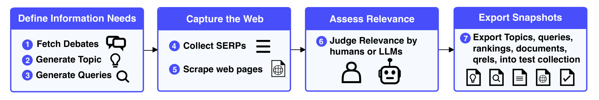

# 📸 SnapIR

[](https://pypi.org/project/snapir/)
[](https://pypi.org/project/snapir/)
[](https://github.com/irgroup/snapir/actions/workflows/ci.yml)
[](LICENSE)

**Capture web search over time.** SnapIR is an open-source toolkit for creating snapshots of live web search: one time snapshots or repeated
(longitudinal) ones. It links information needs, topics, queries, SERPs, captured web pages and relevance judgments across collection dates, so you can study how rankings, AI overviews and page content change, and evaluate retrieval systems on judgments made at the time of the search.



Each step is one CLI command. Steps 4 and 5 are repeated for every snapshot. Steps can be run on their own (for example, bring your own topics and start at step 4), are **resumable** (existing records are skipped) and can be scheduled with the included [Prefect workflows](workflows/README.md).


## Install

```bash
pip install snapir
playwright install chromium          # browser for capturing pages
```

Optional extras: `snapir[prefect]` for the [scheduled workflows](workflows/README.md).

The LLM steps (`topics generate`, `queries generate`, `judgments generate`)
also need [`topic-gen`](https://github.com/irgroup/topic-gen):

```bash
pip install "topic-gen @ git+https://github.com/irgroup/topic-gen.git"
```


## Quickstart: two snapshots of one query

This needs only a [SerpApi](https://serpapi.com) key, no LLM.

```bash
export SERPAPI_API_KEY=...

echo '{"topic_id": "t1", "title": "EU AI Act enforcement", "description": "How is the EU AI Act being enforced?"}' > topics.jsonl
echo '{"topic_id": "t1", "query_id": "q1", "query": "eu ai act enforcement news"}' > queries.jsonl

snapir serps fetch --queries queries.jsonl --output data/serps
snapir documents scrape --serps data/serps/$(date +%F)_queries --output data/docs
snapir documents extract-text --documents data/docs/$(date +%F)
```

Run the same three commands again tomorrow (or later). Then package every day
into a collection:

```bash
snapir export snapshot --serps data/serps --documents data/docs \
  --topics topics.jsonl --queries queries.jsonl --output collection
```

`collection/<YYYY-MM-DD>/` now contains, for each day, the topics, queries,
raw SERPs, the organic ranking as a TREC run, and the extracted page text.


To generate topics and queries from news debates, judge relevance and export
qrels, follow the **[tutorial](examples/minimal-example/README.md)**.

## Commands

```
snapir
├── topics
│   ├── fetch-debates       Collect source debates from euro|topics
│   ├── generate            Generate topics from debates (LLM)
│   └── select              Add a topic and its queries to a curated set
├── queries
│   └── generate            Generate queries for topics (LLM)
├── serps
│   └── fetch               Fetch search results for queries (SerpApi)
├── documents
│   ├── scrape              Capture pages referenced by SERPs (MHTML, screenshot)
│   ├── extract-text        Extract page text, including PDFs
│   ├── review              Inspect screenshots interactively
│   └── clear               Remove flagged captures so the next scrape retries them
├── judgments
│   ├── generate            LLM relevance judgments (-DNA- prompt by default)
│   ├── create-questions    Generate the SoSci question pool
│   └── questionnaire       Build a SoSci questionnaire for human assessors
└── export
    ├── rankings            Rankings as a table
    ├── answers             Human assessments from SoSci
    ├── qrels               Aggregate assessments into TREC qrels
    ├── snapshot            Assemble a distributable collection, one directory per day
    └── verify              Check queries → SERPs → captures → text for gaps
```

`snapir <group> <command> --help` documents every option. <!-- TODO: generated reference at docs/reference/cli.md -->

## Configuration

All settings are environment variables:

| Variable | Used by |
|---|---|
| `SNAPIR_LLM_MODEL`, `SNAPIR_LLM_BASE_URL`, `SNAPIR_LLM_API_KEY` | LLM steps, using any OpenAI-compatible endpoint. Models named `gemini*` use Google GenAI (`pip install "snapir[gemini]"`) |
| `SNAPIR_LLM_TEMPERATURE` (default 1), `SNAPIR_LLM_CONCURRENCY` (default 1) | LLM steps |
| `SERPAPI_API_KEY` | `serps fetch` |
| `BROWSER_PROFILE_DIR` (default `data/.browser_profile`), `EXTENSION_DIR` (default `data/extensions/idcac`) | `documents scrape` |
| `SNAPIR_ROBOTS_USER_AGENT` (default `SnapIR`); bypass with `--ignore-robots` | `documents scrape` |
| `SOSCI_EXPORT_URL` | default for `export answers --sosci` |


## Documentation

- [Tutorial](examples/minimal-example/README.md): run the whole pipeline for one news topic, step by step
- [Concepts](docs/concepts.md): snapshots, IDs, on-disk layout, resuming
- Guides: 
  - [your own topics](docs/guides/own-topics.md)
  - [capture quality](docs/guides/capture-quality.md)
  - [human assessments](docs/guides/human-assessments.md)
  - [LLM assessments](docs/guides/llm-assessments.md)
  - [responsible use](docs/guides/responsible-use.md)
- [Scheduled collection](docs/guides/scheduled-collection.md) with Prefect and Docker ([setup](workflows/README.md))
- [Agent skill](skills/snapir/SKILL.md): lets a coding agent run, resume and diagnose collection builds
- [Dynamic dataset](examples/dynamic-dataset): prompts, topics and queries of the paper's collection and the [analyses](examples/dynamic-dataset/analyses) behind its figures


## Responsible use

SnapIR obeys `robots.txt` by default and does not hide its automation. You are responsible for following the terms of service of the search and scraping providers and for any copyright and data-protection law that applies to the pages you capture. Laws on redistributing captured pages differ by country. 


## License

[MIT](LICENSE)
